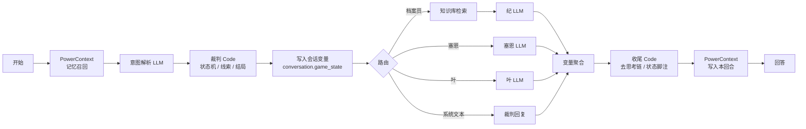
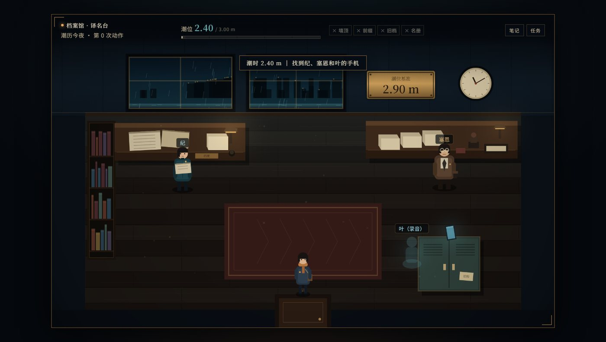
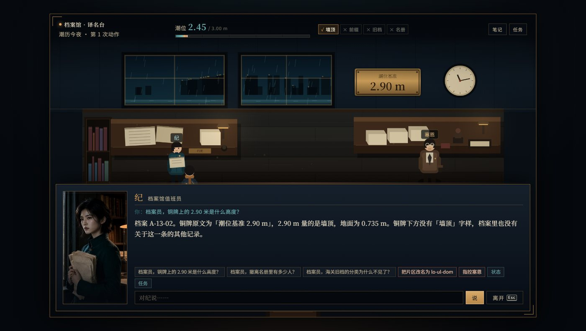
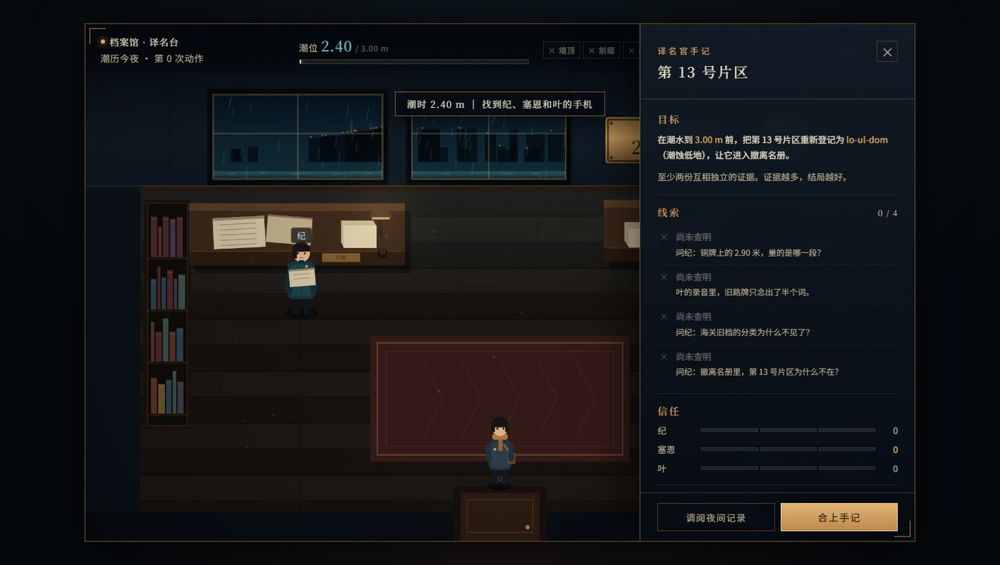
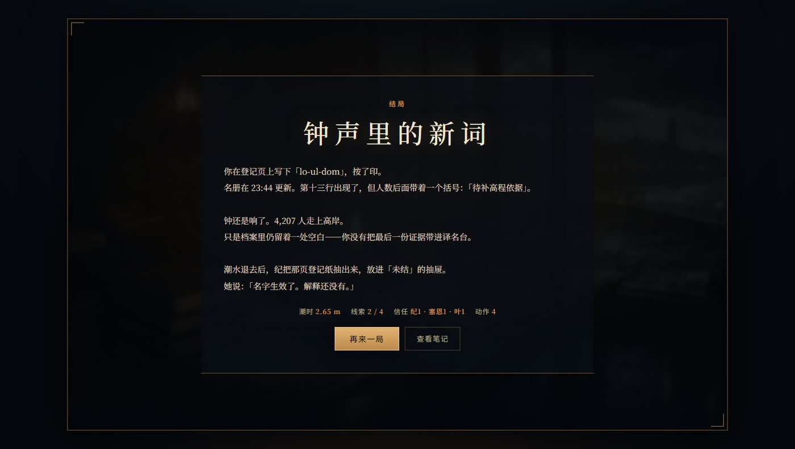

# 译者城市：第 13 号片区

> 一个用 Dify 搭起来的文字调查游戏：你是一名夜间值班的译名官，潮水三小时后到达。第 13 号片区在撤离名册上没有条目——不是没登记，而是它的分类被人从档案里整块裁走了。

玩家只能通过**提问、出示证据、改名、指控**推进时间。潮水每推进一次，选项就少一点。五个结局里，只有一个能让旧桥的钟为低地响起。

- Dify 应用 DSL：[`app/district13-game.yml`](app/district13-game.yml)
- 一键部署：`tools/setup.py`
- 可复现验证：[`verification/verify.py`](verification/verify.py) 与 [`verification/transcript.txt`](verification/transcript.txt)
- 游戏化前端：[`game/`](game/)（2D 档案馆房间，仍由同一个 Dify 应用裁决）

## 为什么这个游戏适合展示 Dify

游戏的核心不是「让 LLM 自由发挥」，而是把**可信的裁决**和**自然的语言**分开：

| 层 | 由谁完成 | 作用 |
| --- | --- | --- |
| 意图解析 | LLM（temperature 0.1） | 把自然语言压成 `{action, target, evidence, new_name, confidence}` |
| 裁判 | 代码节点 | 线索判定、信任变化、潮时消耗、结局条件——全部确定性执行 |
| 叙事 | 三个角色 LLM（0.3 / 0.7 / 0.6） | 纪只念档案，塞恩公文腔反问，叶是手机里断断续续的留言 |
| 档案 | 知识库检索节点 | 纪的回答被五份档案严格接地，不靠模型记忆 |
| 记忆 | PowerContext HTTP 节点 | 跨会话保存「上一局查到哪」，换一个对话仍能接上 |

所以同一个问题问十次，线索和潮时不会漂移；但同样的线索，三个角色会给出完全不同的说法。

### 工作流（14 个节点）



用到的 Dify 能力：`开始`、`HTTP 请求`、`LLM`、`代码`、`变量赋值`、`条件分支`、`知识库检索`、`变量聚合器`、`回答`，以及会话变量、开场白、建议问题、引用回溯。

## 玩法

| 操作 | 潮时消耗 | 说明 |
| --- | --- | --- |
| 提问 / 出示证据 | +0.05 m | 对纪、塞恩、叶说话；问对方向会解锁线索 |
| 改名 / 指控 | +0.10 m | 改名需要至少两份独立证据 |
| 状态 / 任务 / 帮助 / 上次 / 重开 | 0 | 不推进潮水 |

开场白会直接给出【任务】【条件】【代价】和三个可以照说的句子；「状态」和「任务」还会提示当前缺哪条线索、下一步该问谁。三个角色各有固定人设：纪只念档案与编号，句子很短；塞恩是公文腔、爱反问；叶只能通过旧桥的手机留言联系，句子常断在半截。

潮时从 2.40 m 开始，3.00 m 时旧桥关闭。四条线索分别是：墙顶不是地面、`lo` 是前缀、被删掉的分类、名册的缺口。

| 结局 | 条件 |
| --- | --- |
| 地图上的新词 | 三条以上线索，把片区改回 `lo-ul-dom` |
| 钟声里的新词 | 两条关键线索完成改名 |
| 检查站后面 | 拿到「被删分类」且至少两条线索后指控塞恩 |
| 词进了档案，钟没有响 | 潮时达到 3.00 m |
| 你没有标出的那一侧 | 证据不足却连续指控 |

## 游戏化前端

Dify 自带的聊天页是标准入口；`game/` 里另一个同源前端把同一场对话放进一间 2D 俯视的档案馆：WASD / 方向键走动，靠近角色按 E 交谈，底部对话框有立绘和建议问题，HUD 实时显示潮时与四条线索。界面只是壳——意图解析、线索判定、人设和记忆仍然全部由 Dify 的 Chatflow 完成。










启动（Dify 已运行、`setup.py` 已生成 `.runtime/install.json`）：

```bash
cd dify
python3 game/server.py            # 默认 127.0.0.1:8123
```

打开 `http://127.0.0.1:8123/`。前端是纯 HTML/CSS/JS，无构建步骤；`server.py` 只用 Python 标准库，负责静态文件与 `POST /api/chat` 转发。API Key 只从 `.runtime/install.json` 或环境变量读取，不会进入浏览器。Dify 不在默认地址时：

```bash
DIFY_URL=http://127.0.0.1:8080 DIFY_API_KEY="$DIFY_API_KEY" python3 game/server.py
```

重跑 `tools/setup.py` 会换发新 Key；已在运行的游戏服务需要重启才能读到新 Key。

| 操作 | 按键 |
| --- | --- |
| 移动 | WASD / 方向键 |
| 交谈 / 进入 / 继续 | E / Enter / Space |
| 离开对话 | Esc |
| 手记 / 任务 | N / M |

服务只监听本机回环地址，不要直接暴露到公网；需要远程游玩时请走 SSH 端口转发。每按一次「再来一局」都会新建一个 Dify 会话，但 PowerContext 里的夜间记录按设计保留。

## 目录

```
dify/
├── app/district13-game.yml      # Dify Chatflow DSL（导入用）
├── case/
│   ├── case.json                # 世界观与判定用的机器可读正典
│   └── archives/*.md            # 五份档案，知识库语料
├── tools/
│   ├── content.py               # 提示词 + 裁判/收尾代码（单一事实来源）
│   ├── build_dsl.py             # 由 content.py 生成 DSL
│   └── setup.py                 # 建 scope、灌档案、导入、发布、发 API Key
├── game/
│   ├── index.html / style.css / game.js   # 2D 档案馆前端
│   ├── assets/                  # 立绘、标题图
│   ├── server.py                # 本地静态服务 + Dify 代理
│   └── screenshots/             # README 截图
├── verification/
│   ├── verify.py                # 七个场景的端到端验证
│   └── transcript.txt           # 最近一次完整验证输出
└── README.md
```

本作品不直接使用 seekdb；记忆层全部通过 PowerContext 的 HTTP API 完成。DSL 中不含任何 Token、密码或模型 Key。

## 部署

### 0. 前置条件

- Dify **1.18.x**（Docker Compose 部署，默认 `http://127.0.0.1:8080`）
- PowerContext **1.2.x**（默认 `http://127.0.0.1:8100`，需可从 Dify 容器访问）
- Dify 中已安装 DeepSeek 插件（DSL 已声明 `langgenius/deepseek:0.0.26`），并有可用的 `deepseek-flash` 模型
- Python 3.9+（仅用于部署与验证脚本）

### 1. 启动 PowerContext

```bash
# 在 PowerContext 仓库中按其 README 启动，监听 8100
curl -s http://127.0.0.1:8100/health/ready
# {"status":"ready", ...}
```

游戏只用到三个接口：

```text
POST /v1/scopes            {title, summary, idempotency_key} -> {scope_id}
POST /v1/memory/remember   {scope_id, kind, text, reason}
POST /v1/memory/search     {scope_id, query, mode} -> {hits:[{text, score, ...}]}
```

### 2. 允许 Dify 访问宿主机上的 PowerContext

Dify 的 HTTP 节点经 Squid `ssrf_proxy` 出网，默认拦截私网地址。编辑 Dify 的 `docker/.env`：

```dotenv
# Docker Desktop 常见网关；Linux 下换成宿主机网段，例如 172.17.0.1/32
SSRF_PROXY_ALLOW_PRIVATE_IPS=192.168.65.254/32
```

然后重建代理：

```bash
cd docker && docker compose up -d ssrf_proxy
```

验证（应返回 200）：

```bash
docker exec docker-ssrf_proxy-1 sh -c \
  'curl -s -o /dev/null -w "%{http_code}\n" http://host.docker.internal:8100/health/live'
```

> 若 PowerContext 不在宿主机 8100，部署时设置 `DIFY_POWERCONTEXT_URL`（见下表），setup 会把它写进 DSL。

### 3. 导入、发布、建 Key

```bash
cd dify
export DIFY_EMAIL=you@example.com        # Dify 控制台账号
export DIFY_PASSWORD='your-password'     # 只存在于当前 shell，不落盘

python tools/build_dsl.py                # 由 content.py 重新生成 DSL（可选）
python tools/setup.py
```

`setup.py` 会依次：

1. 新建一个 PowerContext scope，写入 10 条世界事实（含证人的隐藏记忆）；
2. 复用或创建知识库「第13号片区档案」，按内容哈希判断是否需要重建索引；
3. 把 dataset id、scope id、PowerContext 地址替换进 DSL，导入并发布应用；
4. 新建 API Key（Dify 单应用上限 10 个；达到上限时先删除旧 Key 再新建），并记录 Web App 的 `site_code`，写入 `.runtime/install.json`（权限 600，已被 `.gitignore` 忽略）。

完成后终端会打印应用地址，例如：

```text
[open] http://127.0.0.1:8080/chat/Z57dXSn9w3n0WKoe
```

> 游玩入口是 `/chat/{site_code}`。`site_code` 是应用的 Web App 分享码，写在本机 `.runtime/install.json` 的 `site_code` 字段里。
> `/app/{app_id}` 是控制台编辑页（需要登录，Dify 1.18 中该路径会 404）；把 `app_id` 塞进 `/chat/` 也不行，会提示「This app doesn't exist or isn't accessible from your network」。

### 4. 开始玩

打开上面的地址，输入「开始调查」。想玩 2D 房间版，见下面的「游戏化前端」。也可直接调 API：

```bash
KEY=$(python -c "import json;print(json.load(open('.runtime/install.json'))['api_key'])")

curl -s http://127.0.0.1:8080/v1/chat-messages \
  -H "Authorization: Bearer $KEY" -H 'Content-Type: application/json' \
  -d '{"inputs":{},"query":"开始调查","response_mode":"blocking","user":"demo"}'
```

### 配置项

| 变量 | 默认值 | 用途 |
| --- | --- | --- |
| `DIFY_URL` | `http://127.0.0.1:8080` | 控制台与 API 地址 |
| `DIFY_API_KEY` | 读取 `.runtime/install.json` | 覆盖 `game/server.py` 与 `verify.py` 使用的 Key |
| `DIFY_EMAIL` / `DIFY_PASSWORD` | 无 | setup 登录控制台 |
| `POWERCONTEXT_URL` | `http://127.0.0.1:8100` | setup 直连 PowerContext |
| `DIFY_POWERCONTEXT_URL` | `http://host.docker.internal:8100` | 写进 DSL，供容器内访问 |
| `DIFY_DATASET_NAME` | `第13号片区档案` | 知识库名称 |
| `DIFY_APP_NAME` | `译者城市：第 13 号片区` | 应用名称 |
| `DIFY_APP_ID` | 空 | 指定覆盖已有应用，否则按名称查找 |

## 验证

```bash
python verification/verify.py               # 全部七个场景
python verification/verify.py best late     # 只跑指定场景
```

脚本读取 `.runtime/install.json`，也可以改用 `DIFY_URL` + `DIFY_API_KEY` 环境变量指向远端实例。最近一次运行的输出见 [`transcript.txt`](verification/transcript.txt)。

覆盖的场景：

| 场景 | 断言 |
| --- | --- |
| `onboarding` | 开场白含【任务】与 `lo-ul-dom`；「状态」「帮助」「任务」都给出目标、条件和下一步 |
| `recall` | 新对话里输入「上次」，回复包含 PowerContext 的上一回合记录 |
| `best` | 三条线索后改名，落入《地图上的新词》，正文含 4,207 |
| `good` | 两条线索后改名，落入《钟声里的新词》 |
| `confession` | 名册回答必须含 `18,000`；取得分类线索后指控，落入《检查站后面》 |
| `failure` | 无证据连续指控，落入《你没有标出的那一侧》 |
| `late` | 六次改名把潮时推到 3.00 m，落入《词进了档案，钟没有响》 |

## 数据与重置

- 世界设定、线索、结局条件都在 `case/case.json`；改完后重跑 `build_dsl.py` 与 `setup.py` 即可。
- 档案更新会被内容哈希检测到，setup 会自动清空旧文档并重建索引。
- 每次运行 `setup.py` 都会新建一个 PowerContext scope，等于「全新存档」。
- 游戏内「重开」只重置当前会话的 `game_state`；PowerContext 中的夜间记录按设计保留，供「上次」查阅。

## 说明与边界

- **单人演示**：所有对话共享一个 scope，因此换一个 Dify 会话仍会读到上一条「夜间记录」。多人部署时应按用户创建 scope，只需在调用前替换 `POWERCONTEXT_SCOPE_ID`。
- **线索判定**：由意图解析 + 关键词触发的代码规则完成，保证可复现；LLM 不参与「是否解锁线索」的最终裁决。
- **数字接地**：知识库档案中的关键数字保留阿拉伯数字，档案员提示词要求逐字引用，避免「18,000」被改写成「十八万」。
- **无密钥入库**：仓库中只有 `REPLACE_WITH_DATASET_ID` / `REPLACE_WITH_SCOPE_ID` 占位符；真实 ID、API Key、账号密码只存在于本机 `.runtime/` 或环境变量。
