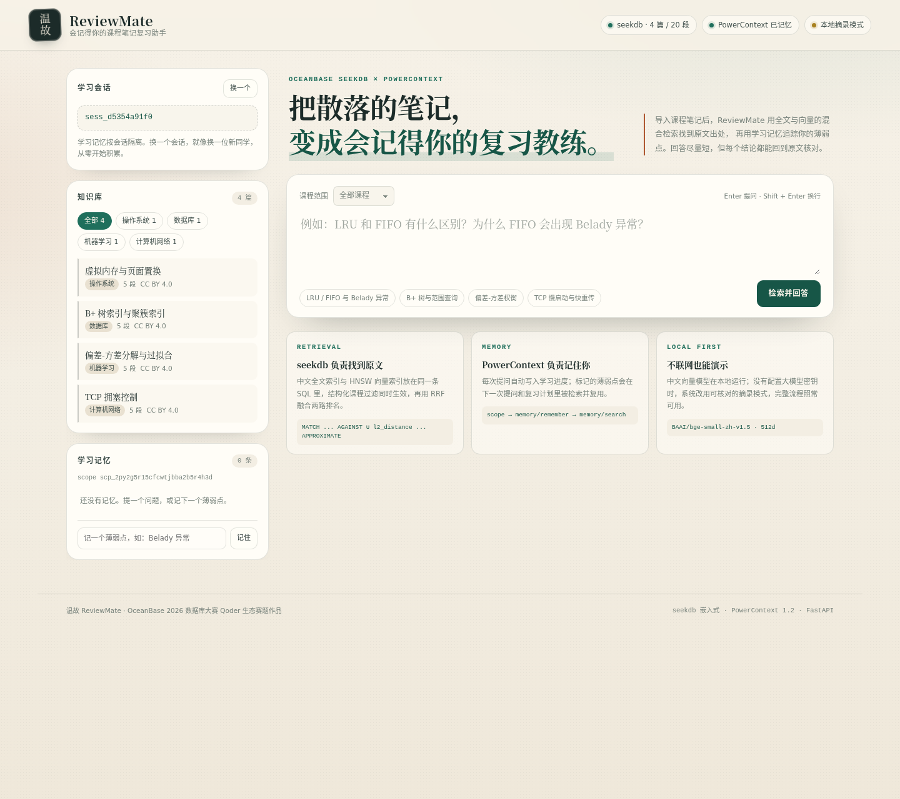

# 温故 ReviewMate

> 把散落的课程笔记，变成会记得你的复习教练。

ReviewMate 是一个面向课程笔记的复习助手：Markdown 笔记导入 [seekdb](https://github.com/oceanbase/seekdb) 后，可以用自然语言检索原文；提问得到的答案带页码与原文引用；你在学习过程中标记的薄弱点由 [PowerContext](https://github.com/oceanbase/powercontext) 记住，并在下一次提问和复习计划里继续使用。

项目使用 **Qoder** 完成开发，并为 **OceanBase 2026 数据库大赛 · Qoder 生态赛道** 准备了可复现的验证材料与项目展示站。



项目展示站：<https://reviewmate-5967u15pefr.qoder.zone> · Qoder Sites 公开访问

代码仓库：<https://github.com/ycl-berserk/2026oceanbase-powercontext> · 分支 `qoder-reviewmate` · 目录 `qoder/reviewmate/`（私有仓库，评审需授权访问）

## 解决的痛点

复习时常见的三个问题：

1. 笔记散落在多门课、多个文件里，关键词想不起来就搜不到。
2. 搜到一段话，却不知道它来自哪一页，无法回到原文核对。
3. 每次复习都从头开始，之前标记的薄弱点在下一个工具里就丢了。

ReviewMate 把「找原文」和「记住你」放在同一个流程里：seekdb 负责找到原文，PowerContext 负责记住学习状态。

## 核心功能

- **混合检索**：全文检索（NGRAM）与 HNSW 向量检索在一条 SQL 中完成，再用 RRF 融合排序。
- **结构化过滤**：按课程过滤候选片段，避免跨课程串答。
- **可核对引用**：每条答案引用都带笔记标题、课程、章节、页码和原文片段。
- **学习记忆**：每次提问自动记录学习进度；可一键标记薄弱点；后续提问会自动检索并复用这些记忆。
- **复习计划**：结合 PowerContext 中的薄弱点与知识库文档，生成可执行的复习步骤。
- **本地优先**：中文 embedding 模型在本地 CPU 运行；未配置大模型时使用可核对的本地摘录模式，全流程仍可用。
- **完整界面**：FastAPI + 原生前端，包含检索轨迹、记忆列表、会话隔离与移动端布局。

## 技术分工

| 组件 | 在本项目中的实际作用 | 可核对位置 |
|---|---|---|
| seekdb（嵌入式） | 存储笔记片段与 512 维向量；同一条 SQL 完成全文 + 向量混合召回；保存问答日志与会话映射 | `src/reviewmate/store.py`、界面「查看检索轨迹」、`data/verification/report.json` |
| PowerContext 1.2.0 | 为每个学习会话建立 scope；记录提问进度与薄弱点；后续提问、复习计划读取并复用记忆 | `src/reviewmate/memory.py`、`src/reviewmate/service.py`、界面「学习记忆」 |
| Qoder | 需求拆解、编码、调试、文档与验收脚本开发；项目站通过 Qoder Sites 发布 | 见 `docs/qoder-dev-log.md` 与提交材料 |

混合检索的核心 SQL 如下（两路各自排序后送入 Python 侧 RRF 融合）：

```sql
(SELECT 'fts' AS channel, ..., MATCH(content) AGAINST(%s) AS fts_score, NULL AS distance
 FROM chunks WHERE MATCH(content) AGAINST(%s)
 ORDER BY fts_score DESC LIMIT %s)
UNION ALL
(SELECT 'vector' AS channel, ..., NULL AS fts_score, l2_distance(embedding, %s) AS distance
 FROM chunks WHERE 1=1
 ORDER BY l2_distance(embedding, %s) APPROXIMATE LIMIT %s)
```

## 快速开始

环境：Linux / WSL，Python 3.11+，可访问外网以下载 embedding 模型（首次运行后离线可用）。以下命令在项目根目录执行。

### 1. 安装

```bash
python3 -m venv .venv
.venv/bin/python -m pip install -U pip
.venv/bin/python -m pip install -e ".[dev]"
cp .env.example .env
```

### 2. 启动 PowerContext

安装方式参见 PowerContext 官方文档。本机使用 1.2.0，以 SQLite 作为后端：

```bash
export POWERCONTEXT_SERVER_DATABASE_URL="sqlite+aiosqlite:////绝对路径/qoder-reviewmate/data/powercontext/reviewmate.db"
powercontext server run --host 127.0.0.1 --port 8100
```

`sqlite+aiosqlite:///` 后接绝对路径时共四个斜杠，例如 `/home/you/qoder-reviewmate/...`。`.env` 中的 `REVIEWMATE_POWERCONTEXT_URL` 默认指向 `http://127.0.0.1:8100`。

### 3. 导入样例笔记

```bash
make ingest
# 等价于：.venv/bin/python -m reviewmate ingest data/samples
```

样例共 4 篇笔记、20 个片段，覆盖操作系统、数据库、机器学习、计算机网络，授权见 `data/samples-README.md`。

### 4. 启动 Web 界面

```bash
make serve
```

打开 <http://127.0.0.1:8090>。首次检索会加载本地中文 embedding 模型，可能需要十几秒。

### 5. 一键验收

```bash
make verify
```

脚本依次核对 seekdb 混合召回、引用页码、PowerContext 写入与复用、复习计划和 QA 日志，输出 PASS/FAIL 表，并生成 `data/verification/report.json`。

最近一次结果：

```
[PASS] 混合检索命中两路: 全文 3 条，向量 5 条
[PASS] 引用可回到原文: 《虚拟内存与页面置换》第 4 页 · LRU 与 FIFO 的对比
[PASS] 自动记录提问
[PASS] 后续提问复用记忆: PowerContext 检索命中 2 条历史记忆
[PASS] 复习计划读取薄弱点: 薄弱点 1 条，覆盖 1 篇笔记
结果：12 通过 / 0 失败
```

## 命令行

```bash
# 提问（可限定课程与会话）
.venv/bin/python -m reviewmate ask "LRU 和 FIFO 有什么区别？" --course 操作系统 --session demo

# 查看知识库与记忆状态
.venv/bin/python -m reviewmate stats
.venv/bin/python -m reviewmate memory --session demo

# 标记薄弱点并生成复习计划
.venv/bin/python -m reviewmate mark-weak "LRU 与 Belady 异常" --session demo
.venv/bin/python -m reviewmate plan --session demo --course 操作系统

# 查看问答记录
.venv/bin/python -m reviewmate history --session demo
```

`ask --json` 会输出完整引用、检索轨迹与耗时，便于脚本核对。

## 配置

复制 `.env.example` 为 `.env` 后按需修改；不提交真实密钥。

| 变量 | 默认值 | 说明 |
|---|---|---|
| `REVIEWMATE_DB_PATH` | `data/seekdb/reviewmate.db` | seekdb 数据文件 |
| `REVIEWMATE_EMBED_MODEL` | `BAAI/bge-small-zh-v1.5` | 本地中文 embedding 模型 |
| `REVIEWMATE_EMBED_DIM` | `512` | 向量维度，需与模型一致 |
| `REVIEWMATE_TOP_K` | `6` | 最终证据条数 |
| `REVIEWMATE_POWERCONTEXT_URL` | `http://127.0.0.1:8100` | PowerContext 服务地址 |
| `REVIEWMATE_LLM_PROVIDER` | `auto` | `auto` / `extractive` / `deepseek` |
| `DEEPSEEK_API_KEY` | 空 | 可选；为空时使用本地摘录模式 |

## 测试与代码质量

```bash
make test   # 单元测试；集成测试需 REVIEWMATE_RUN_INTEGRATION=1
make lint   # ruff
```

## 笔记格式

支持 `.md` / `.markdown` / `.txt`。Markdown 可选 YAML frontmatter：

```markdown
---
course: 操作系统
title: 虚拟内存与页面置换
source: 自编课程笔记
license: CC BY 4.0
tags: 虚拟内存, 页表, LRU
---

# 虚拟内存与页面置换

<!-- page: 1 -->
## 为什么需要虚拟内存
...
```

- `course` 用于课程过滤，缺省时归入「未分类」。
- `<!-- page: N -->` 为后续段落标注页码；没有标记时为 `null`。
- 片段按 H2/H3 聚合，超长再按句子切分，默认 420 字、80 字重叠。

## 目录结构

```
src/reviewmate/    配置、切分、embedding、seekdb、PowerContext、回答与 API
web/               单页界面（原生 HTML/CSS/JS）
data/samples/      4 篇可复现的课程笔记
scripts/verify.py  端到端验收脚本
tests/             切分、RRF、回答与集成测试
site/              项目展示站（已通过 Qoder Sites 发布）
docs/              架构、验证、Qoder 开发记录与提交清单
```

## 展示站与提交

- 项目展示站：<https://reviewmate-5967u15pefr.qoder.zone>（Qoder Sites，公开访问，无需登录）。
- 站点源码：`site/`；更新后需重新发布才会同步到线上。
- 提交仓库：<https://github.com/ycl-berserk/2026oceanbase-powercontext>（私有，评审需授权访问）。
- 提交分支：`qoder-reviewmate`，基于 `origin/2026-competition-ecosystem`；项目路径：`qoder/reviewmate/`。
- 提交 commit：项目内容基线 `56d8579e`；分支最新提交包含仓库地址与文档回填。
- 提交材料清单：见 `docs/submission-checklist.md`。
- Qoder 账号 UID：`aliyun-1585490604181694`。
- 配置示例均为占位值，不包含真实 API Key、密码或其他凭据。

## 许可

代码以 MIT 许可发布。样例笔记为自编课程笔记，采用 CC BY 4.0；embedding 模型遵循其上游许可。
